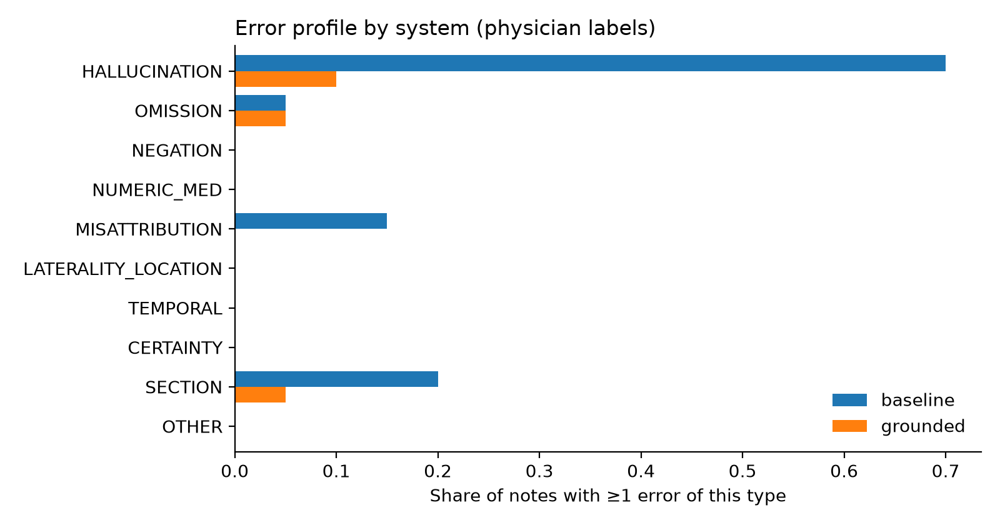
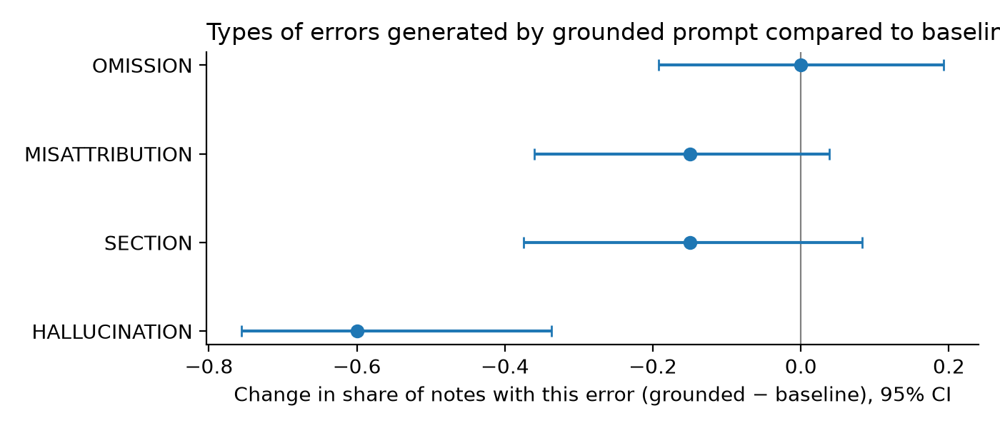

# Where do AI scribes fail?
### A clinician-labeled evaluation of LLM-generated clinical notes

**Key findings:** 
- Adding grounding rules to the prompt cut the share of notes with ≥1 error from 85% to 20% (−65 pp, 95% CI −79 to −38; p = 0.0001; n = 20 paired encounters). No major errors occurred in either arm. 
- Identified a prompt-dependent tradeoff between transcript fidelity and clinical terminology normalization: 
    - Ungrounded notes converted symptoms and exam findings into medical terminology and diagnoses
    - Grounded notes preserved source wording more closely, but in doing so failed to generate medical terms; this pattern could make them less effective for downstream coding and clinical decision-making
- An LLM-as-judge failed to catch many of the errors documented by the physician with a sensitivity of 43% (95% CI 24% to 63%), PPV 64% (95% CI 39% to 84%), and kappa 0.16.

## Questions
1. **Primary:** Does adding grounding rules to the prompt reduce errors in AI-generated notes?
2. Which error types change?
3. Can an LLM-as-judge catch the errors a physician finds?
4. How well does an automated overlap score (ROUGE) track clinical errors?

## Data
20 doctor–patient transcripts:
- **12 from [ACI-Bench](https://github.com/wyim/aci-bench)** 
    - All outpatient visits, test split 1, CC BY 4.0, selected at random. 
    - In addition to the transcript, each has a clinician-written reference note (used only for ROUGE).
- **8 synthetic ED encounters** 
    - Drafted by Claude and revised by the author (a physician) for this project. 
    - Each comes with a checklist of "traps" (62 in total), specific facts a correct note must get right (key details, negations, doses, who said what, etc).

## Approach
**One model, two prompts.** Claude Sonnet 5.5 (`claude-sonnet-5-5`) writes a note from each transcript using either a *baseline* prompt or a *grounded* prompt. The grounded prompt adds rules: document only what was said, preserve negations, give exact doses, attribute statements to the right speaker, and use the correct note section. Both prompts specify the same section headings so the notes look alike. 20 encounters × 2 prompts = 40 notes.
- **Physician annotation (reference standard).** The author, blinded to which prompt produced each note, reviewed all 40 notes in random order and labeled each error with a category (10-category taxonomy) and a severity (1 minor, 2 moderate, 3 major).
- **Pre-specified analysis.** The primary endpoint, statistical test, and α were committed to git before unblinding. One amendment was made before unblinding and is documented in [AMENDMENT.md](AMENDMENT.md).
- **LLM-as-judge.** GPT 6.1 Sol (`gpt-6.1-sol`) labels errors in all 40 notes using the same taxonomy. It comes from a different model family than the note writer, which reduces self-preference bias. It is scored against the physician labels using sensitivity, PPV, and Cohen's κ.
- **ROUGE.** Generated notes are compared with the ACI-Bench reference notes (12 encounters, 24 notes), and the scores are correlated with physician-labeled errors.

## Results  
**Sample:** 20 encounters, each documented by both prompts (40 notes), annotated blind by one physician (taxonomy v1.0).

### 1) Primary endpoint: Notes with ≥1 error of any severity.** 

The primary endpoint was amended from "≥1 major error" to "≥1 error of any severity" before unblinding, because there were no major errors in either arm.
(see [AMENDMENT.md](AMENDMENT.md)).

| Endpoint | N (pairs) | Baseline | Grounded | Difference, pp (95% CI) | p |
|---|---:|---:|---:|---:|---:|
| Any error | 20 | 85.0% (17/20) | 20.0% (4/20) | −65.0 (−78.7, −38.2) | < 0.001 |

**Paired outcomes.** All 13 discordant pairs favored the grounded prompt.

| | Grounded: (+) error | Grounded: NO error | Total |
|---|---:|---:|---:|
| **Baseline: (+) error** | 4 | 13 | 17 (85%) |
| **Baseline: NO error** | 0 | 3 | 3 (15%) |
| **Total** | 4 (20%) | 16 (80%) | 20 |

**Decision:** The grounded prompt is **superior**. p = 0.0001 is less than α = 0.05. 95% CI for the difference (−78.7 to −38.2 pp) excludes 0.

### 2) Secondary Endpoints
#### a) Additional error metrics

| endpoint          |   baseline |   grounded |   difference |   ci_low |   ci_high |   p_value |   n_pairs |
|:------------------|-----------:|-----------:|---------------------:|---------:|----------:|----------:|----------:|
| errors per note   |       1.85 |       0.25 |                -1.6  |   -2.05  |    -1.15  |      0    |        20 |
| ≥1 moderate or major error |       0.2  |       0.05 |                -0.15 |   -0.351 |     0.019 |      0.25 |        20 |
| ≥1 major error    |       0    |       0    |                 0    |   -0.161 |     0.161 |      1    |        20 |

#### b) Which error types does a grounded prompt change?

| category       |   baseline |   grounded |   diff |   ci_low |   ci_high |   p_value |
|:---------------|-----------:|-----------:|-------:|---------:|----------:|------------:|
| HALLUCINATION  |       0.7  |       0.1  |  -0.6  |   -0.756 |    -0.337 |       0     |
| SECTION        |       0.2  |       0.05 |  -0.15 |   -0.374 |     0.082 |       0.375 |
| MISATTRIBUTION |       0.15 |       0    |  -0.15 |   -0.36  |     0.038 |       0.25  |
| OMISSION       |       0.05 |       0.05 |   0    |   -0.193 |     0.193 |       1     |

Categories with zero errors in either arm:
- NEGATION
- NUMERIC_MED
- CERTAINTY
- LATERALITY_LOCATION
- TEMPORAL
- OTHER

#### c) Annotation decision log: tradeoff between transcript fidelity and clinical terminology normalization
- Some ungrounded notes convert symptoms and exam findings into medical terminology and diagnoses
- Grounded notes preserve source wording more closely, but in doing so fail to generate medical terms; this pattern could make them less effective for downstream coding and clinical decision-making
Examples:
1) Migraine ED case: patient reports seeing "zigzag lines" prior to migraine headache onset
    - Ungrounded documents this as "aura"; grounded just refers to it as "zigzag lines"
    - Downstream this affects PMHx and diagnosis:
        - Grounded: "Migraine"
        - Ungrounded: "Migraine with visual aura"
2) Stroke ED case: Chief complaint (CC) varies by prompt
    - Grounded: CC is verbatim and unnecessarily attributed to patient:
        - "Right arm and right leg not working properly (per patient)"
    - Ungrounded: CC is in medical terminology, appropriately derived from the transcript:
        - "Right arm and right leg weakness with slowed speech"
3) CHF case: Only ungrounded note converts symptoms and physical exam findings into medical terms:
    - Ungrounded:
        - Patient reports "difficulty breathing lying down" --> appropriately converted to "orthopnea"
        - On exam, doctor notes "distended neck veins" --> appropriately becomes "jugular venous distension"

#### d) Can an LLM-as-judge catch the errors a physician would?

| system   |   human_any_error_rate |   judge_any_error_rate |   human_major_rate |   judge_major_rate |   human_errors_per_note |   judge_errors_per_note |
|:---------|-----------------------:|-----------------------:|-------------------:|-------------------:|------------------------:|------------------------:|
| baseline |                   0.85 |                   0.55 |                  0 |                  0 |                    1.85 |                    0.75 |
| grounded |                   0.2  |                   0.15 |                  0 |                  0 |                    0.25 |                    0.15 |

| level    | target            |   n |   prevalence |   kappa |   sensitivity |   sens_lo |   sens_hi |     ppv |   ppv_lo |   ppv_hi |   specificity |   tp |   fp |   fn |   tn |
|:---------|:------------------|----:|-------------:|--------:|--------------:|----------:|----------:|--------:|---------:|---------:|--------------:|-----:|-----:|-----:|-----:|
| note     | any_error         |  40 |        0.525 |   0.163 |         0.429 |     0.245 |     0.635 |   0.643 |    0.388 |    0.837 |         0.737 |    9 |    5 |   12 |   14 |
| note     | any_moderate_plus |  40 |        0.125 |   0.094 |         0.4   |     0.118 |     0.769 |   0.182 |    0.051 |    0.477 |         0.743 |    2 |    9 |    3 |   26 |
| note     | any_critical      |  40 |        0     | nan     |       nan     |   nan     |   nan     | nan     |  nan     |  nan     |         1     |    0 |    0 |    0 |   40 |
| category | HALLUCINATION     |  40 |        0.4   |   0.138 |         0.25  |     0.102 |     0.495 |   0.571 |    0.25  |    0.842 |         0.875 |    4 |    3 |   12 |   21 |
| category | OMISSION          |  40 |        0.05  |   0.474 |         0.5   |     0.095 |     0.905 |   0.5   |    0.095 |    0.905 |         0.974 |    1 |    1 |    1 |   37 |
| category | MISATTRIBUTION    |  40 |        0.075 |  -0.039 |         0     |     0     |     0.561 |   0     |    0     |    0.793 |         0.973 |    0 |    1 |    3 |   36 |
| category | SECTION           |  40 |        0.125 |   0     |         0     |     0     |     0.434 | nan     |  nan     |  nan     |         1     |    0 |    0 |    5 |   35 |

### Limitations

One annotator; no second rater. Blinding may have been imperfect because the two
prompts produce notes in recognizably different styles. With n = 20, the CIs are
wide, and severity-specific effects can't be estimated.

### Future directions
- Reannoate a subset of generated notes --> calculate inter-rater agreement
